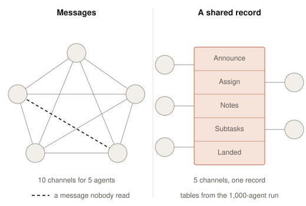
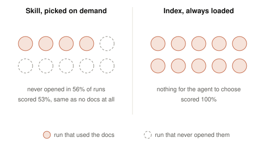
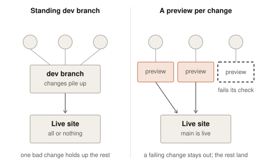
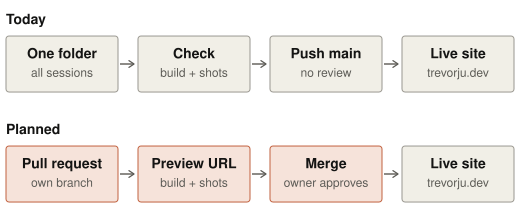
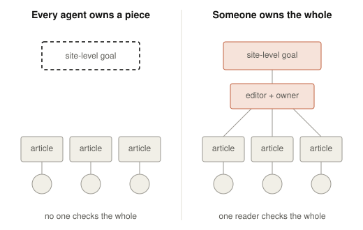

# Agent-native site

A portfolio that any agent session can post to.

Every project page is built from that project's own GitHub repo at a pinned commit. The session that did the work writes it up and adds it from wherever it is working, so nobody has to open the portfolio to update the portfolio.

## Why

A portfolio is normally written after the fact, by its owner, from memory, in a separate project. By then the session that built the thing is gone, along with what it knew: why a choice was made, what was tried and dropped, which number was measured against what.

Two earlier versions of this site tried to be clever about that. One had a chatbot that answered questions about the work. The next designed itself: a generator wrote a page, an evaluator graded it, and the loop ran round after round. The note that parked it reads "the whole loop feels random and unclear; simplify soon."

This version has one idea. The portfolio does not describe projects; it points at them, and the agents doing the work post to it themselves.

## Standard against agent native

The right-hand column is the design. The last column says how much of it exists today.

| | A standard portfolio | Agent native | Here today |
|---|---|---|---|
| Where a page comes from | Written by hand in the portfolio | Built from the project's own repo at a pinned commit | Live |
| Who writes it up | The owner, later, from memory | The session that did the work, while it still knows why | Live |
| Where the work happens | In the portfolio's repo | From any repo, through skills | Live |
| How contributors coordinate | By message, or not at all | Through a shared record: pins, notes, a log, open pull requests | Live |
| How a session finds the site | It has to pick the right tool | A paragraph that is always loaded tells it | Live |
| Seeing a change first | After it is live | A preview per change, with screenshots | Screenshots on every pull request; a preview address is planned |
| Who checks the whole | Nobody; each page stands alone | One reader approves each change against the site's goal | Live: Trevor merges every pull request |
| Who can read it | People with a browser | People and models: a markdown twin of every page | Live |
| Dates and sources | Typed | Read from git | Live |

## How it works

Each project is a git submodule. In this repo it is not a folder of code but a single line that names a repo and a commit. The page for a project is built from that repo at that commit, so every page can say exactly what it was built from, and the "last updated" date is the date of that commit.

A project's page comes from one Markdown file in its own repo, `article/article.md`. It opens the same way every time: a title, one sentence, an abstract. The rules are written down once, in `ARTICLES.md`, so any session can write one.

Adding a project, writing its article, syncing, checking, publishing and archiving are each a skill, shipped as a plugin. A session working in a project repo runs them against its own copy of the portfolio. The check builds the site and then drives it in a real browser and saves screenshots, because a file check cannot see a page that lost its stylesheet.

## A shared record

Sessions in different repos never talk to each other. They read and write the same record.

The 1,000-agent run had no messaging tools at all. Its agents coordinated through a shared database and git, in five tables the lead agent made in the first ten minutes: orders, ownership, notes, subtasks, and the log of what landed [1]. A separate study of agent teams shows what the alternative costs: agents that did not weigh a concern ignored the messages that raised it [3].

Here the record is three things per project. The pin says which commit the page is built from. The notes say what an agent needs to know: what was built, what was dropped, what is parked. The log has one line per update. They are kept true cheaply: when a project moves, only the diff since the pinned commit is read, and only the notes those changes touch are edited.

The other half of those five tables, the record of work in flight, is the list of open pull requests.

## Always loaded

On the day this article was written, a session was asked to add a project to the portfolio. It added it to the wrong one: an older site in a repo that happened to be named `portfolio`. The skill for adding a project was installed and was not used.

That failure has been measured. Vercel tested agents on framework APIs they had not seen in training. A skill holding the documentation was never opened in 56% of runs and scored 53%, the same as no documentation. A short index that was always loaded scored 100% [4].

So a skill carries the procedure, and something always loaded has to say where the portfolio is. The old repos are now archived with a notice in each, and the plugin loads one paragraph into every session as it starts, saying where the portfolio is and which skills run it.

## A preview per change

At first a session pushed to `main` and the push was the deploy. The first time anyone saw a change, it was live.

The obvious fix is a `dev` branch, or a second site for staging. None of the teams I read that run on agents does that. Anthropic's own source control discourages branches other than main and release branches, and moves the gate to just before deploy [2]. What they give each change instead is its own preview.

The site now does the cheap half of that. A session opens a pull request on its own branch. The pull request is built and driven in a browser, and the screenshots are kept with it. Trevor merges, and the merge is the publish. GitHub refuses a direct push to `main`, so there is no other way in. What is still planned is the address: a real page for each pull request to click through, not only pictures of one.

## Owning the whole

Every project's session wants its own article to look good. That is the right instinct for one page and the wrong one for a portfolio.

In Anthropic's study of agent teams, teams did better on the task and worse on ethics than a single agent on all 12 tasks, and one cause was that work was split into pieces with no agent tracking the goal of the whole [3]. A portfolio's whole is whether its claims are honest and its articles read as one body of work.

The article standard and the check cover form. The merge, which only Trevor does, is where a person covers the rest, and the same source control write-up describes what that review becomes: reading the intent of a change, not every line [2]. An editor that reads each new article as a sceptical outsider is an idea, not a plan.

## For models

- **A markdown twin of every page.** Add `.md` to a page's address and you get the article and its notes with no HTML around them.
- **Copy for LLM.** One button copies that twin. Selecting any passage offers to copy it with its source and commit.
- **`llms.txt` and `llms-full.txt`.** One address to find everything, one to read everything.
- **Pages that read without scripts.** Most agents fetch a page; they do not run it.

## What was dropped

- **The chatbot.** It needed a key, a backend and upkeep, and a visitor's own model reading `llms-full.txt` does the job better.
- **An MCP server for the portfolio.** Nobody installs a server to read a handful of articles.
- **Generating the design in an eval loop.** That is a project, not the machinery of a site.
- **The README as the article.** A README says how to use a repo; an article says what the project is and what it achieved.
- **Notes inside each project's `CLAUDE.md`.** That file holds instructions for working in the repo, and mixing history into it meant the site had to write to every project.
- **A `dev` branch.** See above.

## Not done yet

A preview address for each pull request. There is no dark mode, one project's page is still built from its README, and the home page still shows placeholder rows.

## Sources

1. [Safely scaling multi-agent teams with Claude Fable 5.2](https://claude.dev/blog/safely-scaling-multi-agent-teams-with-fable-5-2/), Anthropic, November 2026.
2. [Redesigning source control at Anthropic](https://www.anthropic.com/research/redesigning-source-control), Anthropic, October 2026.
3. [AI Organizations Can Be More Effective but Less Aligned than Individual Agents](https://alignment.anthropic.com/2026/ai-organizations/), Anthropic, 2026.
4. [AGENTS.md outperforms skills in our agent evals](https://vercel.com/blog/agents-md-outperforms-skills-in-our-agent-evals), Vercel, January 2026.
