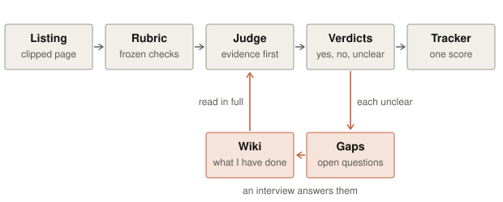

# job-app

A job search run as an eval: every listing becomes a rubric, and a judge answers it from a wiki about me.

Clipping a listing turns its requirements into measurable checks. A judge answers each check with evidence from a wiki of my own experience, and every check it cannot answer becomes a question that makes the wiki better for the next listing.

## Why

The usual way to automate a job search is to parse every listing into fields: location, salary, years required, tech stack. Every job board formats those differently, so the parser never finishes.

The other way is to decide what you want to know and check only that. A listing already says what it wants in its own words. Turn each requirement into a statement that is true or false about me, answer it from a record of what I have done, and the listing is judged the way an eval judges a model [2].

## Design



There are four parts, and each one has a single job.

| Part | What it is | Its job |
|---|---|---|
| Wiki | About 60 Markdown pages about me | The evidence. Nothing about listings goes in it |
| Rubric | One per listing, generated once and frozen | Turns the listing's requirements into checks |
| Judge | A subagent with one prompt | Answers each check: evidence, then yes, no or unclear |
| Tracker | A page with a small database | Holds every listing, its rubric and its verdicts |

The same judge can run three ways by changing what it reads. From the listing's rubric against the wiki, it asks whether I qualify. From my own rubric against the listing, it asks whether I want the job. From the listing's rubric against a resume, it asks whether the resume shows what the wiki knows. Only the first is built.

## Wiki

The wiki follows the LLM-wiki pattern [1]: raw sources that are never edited, pages an agent writes from them, and an index. Mine adds a few rules, each learned from a mistake.

- Every claim names the source it came from: a resume, a transcript, a GitHub README, or a dated interview with me.
- Pages are hubs and spokes. A skill page links to the jobs and projects where the skill was used, which is where a judge finds evidence for "has used X".
- Negatives are recorded. "Has not used Spark" is a line in the wiki, so the question stops coming back.
- Ask, never make up. A missing date is a question for me, not a guess.

## Rubrics

A check is one requirement about the candidate, written so that true is the good outcome. Most of the work is in deciding where one requirement ends.

```text
Could a candidate satisfy this sentence by meeting only one of its parts?

Yes ("or", "such as", "any of")   keep it as ONE check, worded "at least one of ..."
No, every part is needed          split it into one check per part
Unsure                            keep it as one check
```

A rubric keeps the listing's own section names. The only field added is a tier: `must` when the listing words the section as a requirement, `nice` when it words it as optional. "You might thrive in this role if" is `nice`.

Lines with nothing to verify, such as "owns their work" or "intellectually curious", are `soft`. They are kept out of the rubric and stored beside it, and the judge never sees them.

## Judge

The judge is a model-based grader [2]. It is given the rubric, the whole wiki in one file, and today's date. It is told nothing about the listing or what answer is hoped for.

| Verdict | When |
|---|---|
| yes | The wiki shows I did or have the thing |
| no | The wiki says I did not, or states a limit that rules it out |
| unclear | The wiki says nothing that settles it |

Evidence is written before the verdict, with the page it came from. Absence is unclear, never no. One skill is never inferred from another.

It reads the whole wiki because a missed page is the costliest error here. A check that comes back unclear turns into a question for me, so a retrieval miss means being interviewed about something already written down. The wiki is about 10,000 tokens, which fits in one read many times over.

## Gaps

Every unclear verdict is appended to a list of gaps. An interview groups the open gaps by topic and asks me about them. My answers are saved word for word as a new source, the wiki is updated from that source, and the listings are judged again.

This is the part that compounds. A question about distributed systems asked by one listing is answered once, and every later listing that asks it gets a verdict with a citation.

## Skills

The system ships as a Claude Code plugin. Each skill is a noun, and its verbs are arguments.

| Skill | Verbs |
|---|---|
| `wiki` | `ingest`, `query`, `interview`, `lint` |
| `rubric` | `extract`, `refine` |
| `judge` | `qualify`, with `prefer` and `review` planned |
| `artifact` | `open`, `track`, `update` |

The rubric generator and the judge are subagents with their own prompt files, so the prompt that gets tuned is one file, and the model it runs on does not depend on the session that launched it.

## Results

Twelve listings, 125 checks.

- **Unclear verdicts fell from 41 to 5.** The first full run left 41 of 125 checks unclear. A university transcript and two interviews brought that to 13. Fixed readings in the judge's prompt and judging each listing three times brought it to 5.
- **About one check in ten varies between runs.** On 24 checks judged three times each on an unchanged wiki, 22 got the same verdict all three times.
- **Three runs mostly agree.** Judging all twelve listings three times, 116 of 125 checks were unanimous. The majority verdict is the one kept.

Each listing gets one score: the share of its checks answered yes, with a `must` counting twice a `nice`.

## What did not work

- **Keeping every line of the listing as a check.** On the first real listing, 22 of 31 checks were traits such as "communicates clearly". Every one would have come back unclear and turned into an interview question no document can answer. Only measurable lines are checks now, which took that listing to 9.
- **Rewriting the prompt to make the judge consistent.** Fixed readings for loosely worded checks removed most unclear verdicts, but agreement between runs did not improve: 21 of 24, against 22 of 24 before. Outputs vary between runs, so the answer was more runs, not more words [2].
- **Counting years of experience from dates.** The wiki recorded three ways to count, and the judge picked a different one depending on a listing's wording. One stated figure in the wiki replaced all three.
- **Calling required sections "gating".** The word promised that one miss fails a listing, which was never a rule. The tier now says only how the listing words a section.
- **Showing every check as a dot.** A row of marks per listing was harder to read than one number.

## Limits

- Nobody has checked the judge against a human's verdicts. Agreement between runs is not the same as being right.
- The score hides how thorough a rubric is. A listing with four checks and one with seventeen can both score 100.
- A section with no required wording produces a rubric with no `must` checks at all.
- The weights and the score's colour bands are choices, not measurements.
- One person's wiki and twelve listings in one field.

## Next

- The other two judges: my own rubric against a listing, and a listing's rubric against a resume.
- A resume written from the wiki and revised against that second judge.
- An eval for the rubric generator and the judge, with listings whose correct rubric is known.

## Sources

1. [LLM Wiki](https://gist.github.com/karpathy/442a6bf555914893e9891c11519de94f), Andrej Karpathy, GitHub gist, April 2026. The pattern the wiki follows.
2. [Demystifying evals for AI agents](https://www.anthropic.com/engineering/demystifying-evals-for-ai-agents), Anthropic, January 2026. The structure of an eval, model-based graders, and running several trials because outputs vary.
